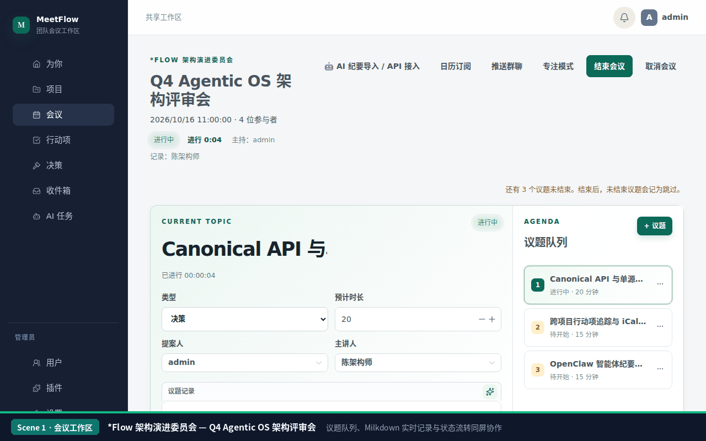

<div align="center">

# MeetFlow

**支持议题计时、结构化结论提取（@决策/@行动/@开放问题）与 AI 纪要原子导入的团队会议工作台。**

[](https://github.com/mcocdaa)
[](https://github.com/mcocdaa/MeetFlow/actions/workflows/ci.yml)
[](https://github.com/mcocdaa/MeetFlow/releases)
[](https://github.com/mcocdaa/MeetFlow/pkgs/container/meetflow)
[](https://www.python.org/)
[](compose.yaml)
[](LICENSE)

[**English**](README.md) · [**简体中文**](README_CN.md)



</div>

---

## ✨ 核心特性

- **实时议题工作台与专注模式**：围绕“待开始 → 会议进行中 → 已结束”生命周期推进议题，内置单议题倒计时、实际耗时统计、乐观锁并发保护（`expected_version`）与会后只读档案快照。
- **行内结构化结论自动提取**：在议题 Markdown 记录中直接书写 `@决策:`、`@行动:`、`@开放问题:`，保存时自动同步至跨会议追踪视图，同时保留手动添加的独立产出。
- **AI 纪要原子导入接口（Headless Ingestion）**：支持通过个人访问令牌（`X-API-Key: mf_...` 或 `Authorization: Bearer mf_...`）调用 `POST /api/v1/meetings/{id}/ingest`，一键写入议题纪要并自动提取结构化结论与行动项。
- **周期会议系列与日历订阅**：支持按天、周、月、年配置带 IANA 时区的固定周期会议系列及临时加会，提供标准 iCalendar（`.ics`）订阅源。
- **项目级权限治理与群机器人通知**：内置项目角色（负责人 `lead`、成员 `member`、干系人 `stakeholder`）与单场会议嘉宾邀请边界，支持飞书、企业微信、钉钉及通用 Webhook 纪要推送。
- **加固单容器生产部署**：公开多架构镜像（`ghcr.io/mcocdaa/meetflow`，支持 `linux/amd64` 与 `linux/arm64`），基于 FastAPI + Vue 3 + SQLite 构建，默认支持只读根文件系统与非特权运行。

---

## 🚀 快速开始

### 方式一：公开容器镜像部署（推荐）

在部署目录复制 `.env.example`，配置至少 12 位的 `ADMIN_PASSWORD`、长期保存的 `APP_SECRET_KEY` 以及 `TRUSTED_ORIGINS`（HTTPS 域名），并在 `127.0.0.1:8000` 启动：

```bash
cp .env.example .env && chmod 600 .env
# 编辑 .env：设置 ADMIN_PASSWORD、APP_SECRET_KEY（可用 python3 -c "import secrets; print(secrets.token_urlsafe(48))" 生成）与 TRUSTED_ORIGINS
docker run -d --name meetflow --init --read-only --tmpfs /tmp:size=64m \
  --security-opt no-new-privileges:true --restart unless-stopped \
  -p 127.0.0.1:8000:8000 -v "$PWD/data:/app/data" --env-file .env \
  ghcr.io/mcocdaa/meetflow:latest
```

也可以使用 Docker Compose 快速启动并检查健康状态：

```bash
MEETFLOW_IMAGE=ghcr.io/mcocdaa/meetflow:latest docker compose up -d
curl http://127.0.0.1:8000/api/health
```

### 方式二：本地源码开发

需要 **Python 3.12+** 与 **Node.js 22+**：

```bash
python -m venv .venv
.venv/bin/python -m pip install -e '.[test]'
npm --prefix frontend ci
./scripts/start.sh local
```

- **后端服务与健康检查**：`http://127.0.0.1:8000`（`/api/health`）
- **前端开发服务器**：`http://localhost:5173`

---

## 🤖 AI 纪要导入接口

在「个人中心 → API 密钥」生成个人访问令牌（`mf_...`，或调用 `POST /api/v1/auth/tokens`），即可通过单次请求将外部语音转写或大模型总结原子化写入指定会议：

```bash
curl -X POST "http://127.0.0.1:8000/api/v1/meetings/<MEETING_ID>/ingest" \
  -H "X-API-Key: mf_your_personal_access_token" \
  -H "Content-Type: application/json" \
  -d '{
    "agenda_title": "架构评审与发布同步",
    "auto_complete_agenda": true,
    "notes_markdown": "### 讨论结论\n- @决策: v1.0 采用单容器 SQLite 持久化部署架构\n- @行动: 完善反向代理 HTTPS 与备份巡检清单 @admin\n- @开放问题: Webhook 失败重试是否需要自定义退避策略？"
  }'
```

接口会自动匹配或新建对应议题、解析同步 `@决策:` / `@行动:` / `@开放问题:` 产出，并记录活动审计日志。

---

## 🛠️ 测试与构建验证

```bash
.venv/bin/python -m pytest -q
npm --prefix frontend test
npm --prefix frontend run build
```

---

## 📚 进一步文档与许可证

- **[运维指南](docs/operations.md)**：HTTPS 反向代理、`.env` 密钥边界、版本升级回滚、数据备份恢复与生产插件挂载。
- **[发布指南](docs/release.md)**：GitHub Actions、GHCR 多架构镜像发布与版本标签规范。
- **[开发与维护文档](docs/README.md)**：系统架构索引、本地开发与数据库迁移（[docs/development.md](docs/development.md)）、插件契约（[backend/app/plugins/README.md](backend/app/plugins/README.md)）。
- **开源许可**：本项目基于 [MIT License](LICENSE) 开源。
